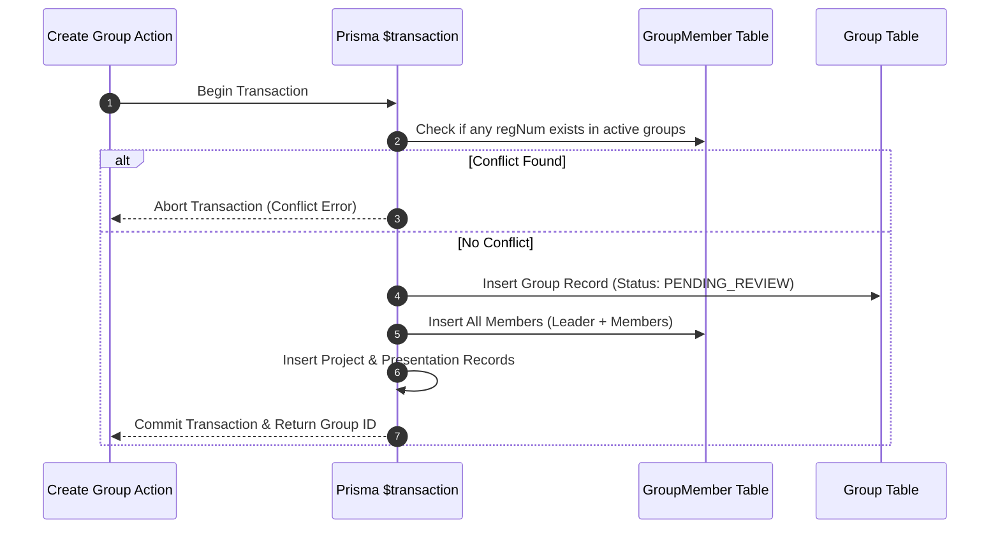

# Backend Architecture & API Specification: BS IT 5th Semester

## 1. Overview & Service Decomposition
The backend layer of the BS IT 5th Semester Group Management System is constructed using Next.js App Router Route Handlers and Server Actions, executing on Node.js. 

To maintain clean separation of concerns and honor the maximum 60 lines per file policy, the backend business logic is strictly decomposed into dedicated, cohesive service layers:
- `lib/services/group.service.ts`: Handles group creation, updates, and member uniqueness validation.
- `lib/services/section.service.ts`: Resolves section boundaries, validation, and group aggregations.
- `lib/services/presentation.service.ts`: Manages presentation state transitions and audit logging.
- `lib/services/stats.service.ts`: Computes real-time dashboard counts directly from PostgreSQL.
- `lib/services/pdf.service.ts`: Orchestrates server-side PDF generation for individual and section exports.
- `lib/services/audit.service.ts`: Records administrative state modifications.

## 2. API Endpoints & Route Specifications
All API endpoints follow RESTful conventions with JSON payloads and HTTP status codes:

### A. Authentication & User Context
- `POST /api/auth/[...nextauth]`: Handles credentials authentication, role assignment, and JWT session issuance.
- `GET /api/me`: Returns the authenticated user's profile, role (`STUDENT` or `ADMIN`), and assigned section.

### B. Group Management Endpoints
- `GET /api/groups?section=m1&status=APPROVED`: Retrieves filtered groups for a specific section with pagination support.
- `GET /api/groups/[id]`: Fetches a complete group dossier including leader, members, project details, review history, and presentation status.
- `POST /api/groups`: Creates a new group profile. Requires authenticated student session matching the section.
- `PUT /api/groups/[id]`: Updates or resubmits a rejected group profile.

### C. Administrative Endpoints
- `GET /api/admin/stats`: Returns real-time counts: `totalM1`, `totalM2`, `totalGroups`, `pendingReviews`, `approvedGroups`, `rejectedGroups`, `pendingPresentations`, `completedPresentations`.
- `PATCH /api/admin/groups/[id]/review`: Updates group review status (`APPROVED` or `REJECTED`) with mandatory rejection reason.
- `PATCH /api/admin/groups/[id]/presentation`: Marks presentation as `COMPLETED` or resets to `PENDING`.
- `GET /api/admin/audit-logs`: Retrieves chronological audit trail for administrative actions.

### D. Document Export Endpoints
- `GET /api/export/group/[id]`: Generates and streams an individual group profile PDF.
- `GET /api/export/section/[code]`: Generates and streams a comprehensive section-wide group report PDF.

## 3. Server-Side Validation Rules
Every mutation passes through strict Zod schema validation:
- **Group Name**: String, 3 to 100 characters, trimmed of excessive whitespace.
- **Section**: Restricted to enum values `M1` or `M2`. Must match the student's assigned section.
- **Roster Count**: Minimum 2 members (Leader + Member 2), maximum 7 members.
- **Registration Numbers**: Normalized format `YYYY-AG-XXXX` or standard UAF alphanumeric format.
- **External URLs**: Validated as HTTPS or HTTP protocol schemes. No `javascript:` or `data:` URIs allowed.

## 4. Transactional Invariants & Concurrency
Group creation executes within an atomic PostgreSQL transaction (`prisma.$transaction`):

## 5. Error Classification & Status Codes
- `400 Bad Request`: Validation failure on input schema or malformed request payload.
- `401 Unauthorized`: Missing or invalid session token.
- `403 Forbidden`: Authenticated user lacks permission (e.g., student attempting admin action or wrong section).
- `404 Not Found`: Target group or section does not exist.
- `409 Conflict`: Registration number is already assigned to another active group.
- `500 Internal Server Error`: Unhandled exception; internal details masked from client.
