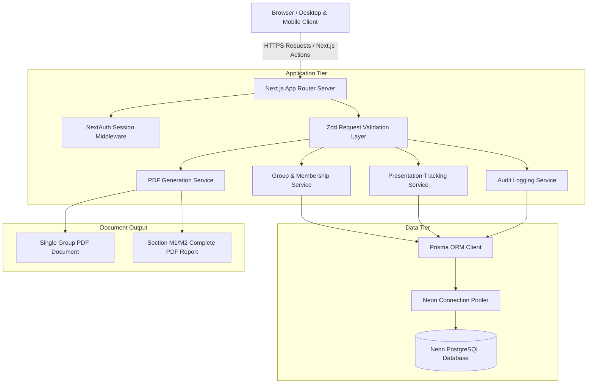
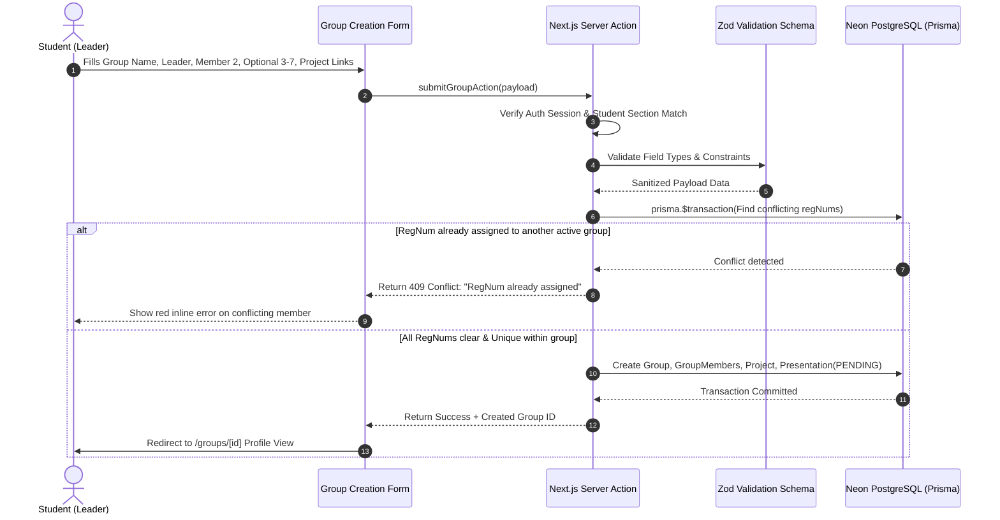

# System Design Document: BS IT 5th Semester Group Management System

## 1. Executive Summary & Architecture Overview
The University of Agriculture Faisalabad (UAF) Department of Information Technology requires a secure, production-grade web application to manage academic project groups for the BS Information Technology (BS IT) 5th semester, strictly segregating Section M1 and Section M2. 

The system provides end-to-end management of student registration, team roster assembly (2 to 7 members), project proposals, external documentation references, administrator review workflows, presentation status tracking, and automated PDF report generation.

The architecture follows modern full-stack web standards using Next.js (App Router), TypeScript, Prisma ORM, and PostgreSQL hosted on Neon. Every source code module is architected under a strict modularity principle of 60 lines or fewer per file.

## 2. System Boundaries & Tier Segregation
The application is segmented into five well-defined architectural tiers:
- **Presentation Tier**: Next.js React Server Components (RSC) and focused Client Components styled with Tailwind CSS, delivering a restrained academic neumorphic user interface.
- **Application & API Tier**: Next.js App Router Route Handlers and Server Actions, providing server-side validation with Zod, session resolution via NextAuth, and role-based access enforcement.
- **Service Tier**: Decoupled service modules for group management, section isolation, presentation tracking, audit logging, and document generation.
- **Persistence Tier**: Relational PostgreSQL database managed via Prisma ORM, deployed on Neon Serverless Postgres with connection pooling.
- **Reporting Tier**: Server-side document rendering engine utilizing jsPDF to construct printable group profiles and section-wide matrices.

## 3. High-Level Architecture Diagram

## 4. Component Architecture & Decomposition
To enforce the strict rule of <= 60 lines per source code file, all system components are hierarchically decoupled:
1. **Atoms & Primitives**: Badges, buttons, text inputs, card surfaces with neumorphic drop-shadows.
2. **Form Partials**: Section headers, leader inputs, member row items, project metadata fields, external URL validators.
3. **Table Sub-components**: Table headers, table rows, expandable description cells, action dropdowns.
4. **State Hooks & Handlers**: Isolated custom hooks for search debouncing, tab switching, and modal confirmation states.
5. **Layout Shells**: Responsive sidebar navigation, application topbar with university emblem and prominent "IT" branding.

## 5. End-to-End Request Lifecycle
The request lifecycle guarantees server-authoritative integrity:
1. **Client Action**: The user submits a form or triggers a presentation state toggle.
2. **Edge Middleware**: Next.js middleware inspects session tokens, verifying authentication and role constraints (`STUDENT` vs `ADMIN`).
3. **Route Handler / Server Action**: Receives validated session data. Client-submitted section identifiers or user claims are discarded in favor of authenticated session claims.
4. **Zod Validation**: Payloads are parsed against strict schemas. Incomplete member blocks or malformed URLs are rejected before touching the database.
5. **Transactional Mutation**: Multi-record operations (e.g. creating a group and inserting 2–7 member rows) run inside `prisma.$transaction`.
6. **Constraint Verification**: Database uniqueness constraints verify that registration numbers are not already assigned to active groups across any section.
7. **Audit Record Dispatch**: Any state change (especially by administrators) writes an immutable record to the `AuditLog` table.
8. **Response / Revalidation**: Next.js cache revalidation triggers fresh view rendering on the client.

## 6. Data Flow Diagram: Group Submission & Verification

## 7. Error Handling & Fault Isolation
- **Server-Side Boundary**: Database connection faults or constraint violations are caught and translated into user-friendly error messages without exposing Neon connection strings or database internals.
- **Client-Side Boundary**: Next.js `error.tsx` and custom error toasts present actionable guidance.
- **Safe Recovery**: Form inputs persist in client component state upon validation failure to prevent data loss.

## 8. Deployment & Environment Architecture
- **Web Runtime**: Node.js 18+ runtime on Vercel or Node container.
- **Database**: Serverless PostgreSQL on Neon with SSL mode `require` and pooled connection endpoint for serverless execution.
- **Static Assets**: UAF emblem and icons served through Next.js static asset optimization pipeline.
